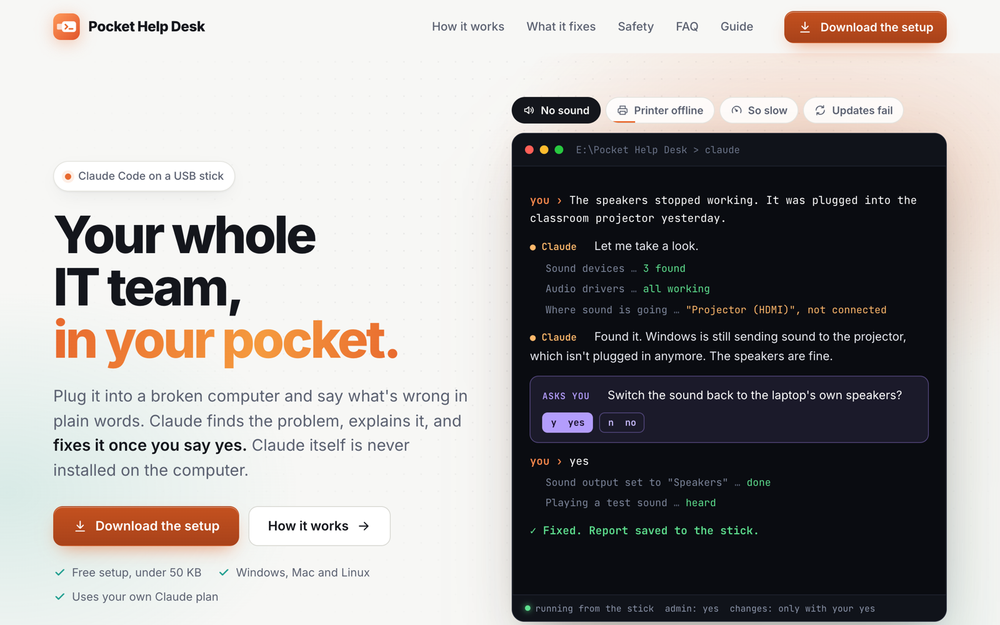
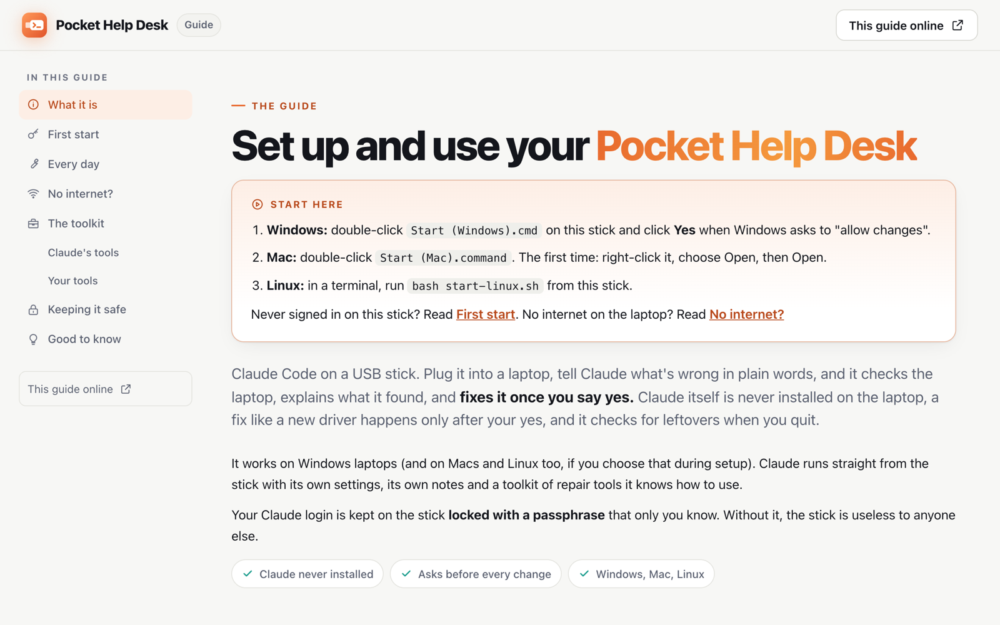
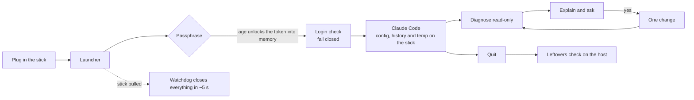

<h1 align="center">Pocket Help Desk</h1>

<p align="center"><b>Your whole IT team, in your pocket.</b><br>
Claude Code on a USB stick. Plug it into a broken Windows, Mac or Linux computer, say what's wrong in plain words, and Claude finds the problem, explains it and fixes it once you say yes. Nothing is installed, nothing is left behind, and a lost stick stays locked.</p>

<p align="center">
  <a href="https://pockethelpdesk.com"><b>Website</b></a> ·
  <a href="https://pockethelpdesk.com/guide/"><b>Guide</b></a> ·
  <a href="docs/DESIGN.md"><b>Design and safety model</b></a> ·
  <a href="SECURITY.md"><b>Security</b></a>
</p>

<p align="center">
  <a href="LICENSE"></a>
  
  
  <a href="https://github.com/dynamiclly-dev/pocket-help-desk/actions/workflows/ci.yml"></a>
</p>

<p align="center"></p>

---

## Why it exists

Most computer problems are small: sound going to the wrong device, a printer queue stuck, a driver that never finished updating. The person sitting in front of the computer can't fix them, and the person who can isn't there.

Pocket Help Desk puts a capable assistant on a stick you can hand to anyone. It runs **from the stick**, uses **your own Claude plan**, and follows ground rules made for someone else's computer: look first, explain in plain words, and ask before every change.

## What makes it different

| Promise | How |
|---|---|
| **Nothing installed** | Claude Code, Codex and every tool run from the stick. Settings, history and temp files are redirected onto it, so the host's home folder stays clean. |
| **Nothing left behind** | Quitting checks the host's usual places for leftovers. Pulling the stick out closes everything within about 5 seconds. |
| **A lost stick stays locked** | Claude's login is a 1-year token locked with your passphrase using [age](https://github.com/FiloSottile/age). It's unlocked straight into memory each session, and a token that fails is never replaced by a login saved on the host. |
| **Asks before every change** | Ground rules in [`stick/work/CLAUDE.md`](stick/work/CLAUDE.md): diagnose read-only, explain, then one change at a time, each after a yes. Personal files, passwords and security software are off limits. For Claude this is enforced by its permission prompts; for Codex on Windows it rests on the ground rules alone. |
| **A repair toolkit** | Sysinternals, smartmontools, BlueScreenView and more for Windows, plus the built-ins on macOS and Linux. Claude is taught to use them in [`stick/work/TOOLS.md`](stick/work/TOOLS.md). |
| **Verified downloads** | The builders fetch pinned versions from official sources. Claude Code, Codex, age and every GitHub-hosted tool are checked against the publisher's SHA-256; Windows toolkit binaries are checked against their Authenticode signatures, and a broken signature stops the build. Nothing is redistributed. |
| **One stick, six platforms** | Windows, macOS and Linux on x64 and arm64, all on one exFAT stick. |

## Quick start

**1. Make a stick.** On Windows, download **[pocket-help-desk-setup.zip](https://github.com/dynamiclly-dev/pocket-help-desk/releases/latest/download/pocket-help-desk-setup.zip)** (scripts only, under 50 KB), unzip it and run **`Set up my stick.cmd`**. It finds your USB stick, offers to format it, and downloads everything from official sources. On macOS or Linux, format the stick as exFAT and run:

```bash
./build-stick.sh /Volumes/PocketHelp              # all six platforms
./build-stick.sh /Volumes/PocketHelp mac-arm64    # or just some
```

**2. Plug it in and start.** Double-click `Start (Windows).cmd` or `Start (Mac).command`, or run `bash start-linux.sh`. The first start signs you in through a private browser window and asks you to choose a passphrase.

**3. Say what's wrong.** *"The speakers stopped working."* Claude looks, explains what it found, and asks before it fixes anything.

Not technical? The [guide](https://pockethelpdesk.com/guide/) walks through everything, and every stick carries it as `Guide.html`, which works offline.

<p align="center"></p>

## How it works



- **Isolation:** the launcher points `CLAUDE_CONFIG_DIR`, `CODEX_HOME`, `TMPDIR` and friends at the stick, turns off auto-updates, and drops inherited API-key variables.
- **Logins:** Claude's token is locked with age (scrypt). Codex is a guest by default: it signs in each session and keeps its login in memory only.
- **Sign-in pages** open only in a private browser window. If no private-capable browser is available, the link is shown on screen instead. (Codex's guest sign-in uses a link and code; see the design doc.)
- **Fail closed:** a short login check runs before Claude starts. A rejected token stops the launch, so Claude never falls back to a login stored on the host.

## Threat model

**Protected:**
- The Claude login at rest: a lost stick holds only an age-encrypted token (scrypt, ~1 s per guess), and the token can be revoked from the Claude account.
- The host's home folder, Keychain and Credential Manager: no login and no program settings are written there.
- The host itself: every change needs a yes, one at a time.

**Not protected (and no program could do it):**
- What the host OS copies out of memory on its own: pagefile, hibernation file, crash dumps.
- A compromised host that watches the keyboard or the screen.
- Chat history on the stick, which isn't encrypted (the owner's choice). It can mention details of machines that were repaired.
- OS-level traces: Windows USB device history, Prefetch, Defender scan history; macOS and Linux mount logs.
- A passphrase that's weak. Four or more random words is the recommendation.

The full design, the rejected alternatives, three read-only reviews by a second model (Codex), and the known limits are in **[docs/DESIGN.md](docs/DESIGN.md)**.

## Tested on real hardware

Each OS's stick was built by that OS's own builder and tested on real sticks with real yanks (October 2026; details and dates in the design doc).

| Host | What was checked | Result |
|---|---|---|
| Windows 11 | login plumbing, leak test, real yank, BitLocker'd stick, admin toolkit | 11/11, clean, closes within ~5 s |
| macOS 26 (arm64, stock bash 3.2) | login lock, leak test, Keychain before and after | 18/18, clean, Keychain unchanged |
| Ubuntu (x64, exFAT) | login lock, leak test, Codex commands | 18/18, clean |

The tests are in [`tests/`](tests/). Run them yourself:

```bash
bash tests/leak-test.sh /Volumes/PocketHelp           # macOS / Linux: run with an empty fake profile, list leaks
python3 tests/login-lock-test.py <throwaway copy>      # login + Codex-mode flows in a real terminal
```
```powershell
pwsh -File tests\leak-test.ps1 -Stick E:\
pwsh -File tests\login-plumbing-test.ps1 -Stick <throwaway copy>
```

The login tests are destructive by design: they refuse any folder without a `.disposable-test-stick` marker. The leak tests never unlock a real login.

## Repository layout

```
Set up my stick.cmd    one-click Windows setup (runs setup.ps1)
build-stick.ps1        Windows builder          } same output, same pinned versions
build-stick.sh         macOS / Linux builder    }
versions.txt           the tested Claude Code / Codex / age versions
stick/                 copied onto every stick
  system/launch.*      the launchers (Windows / macOS + Linux), kept in step
  work/CLAUDE.md       ground rules for Claude (copied to AGENTS.md for Codex)
  work/TOOLS.md        what Claude knows about the toolkit
  Guide.html           the people guide, also published as the website's /guide/
site/                  the homepage (pockethelpdesk.com)
tools/                 toolkit list + downloader, setup-zip packager, website builder
tests/                 leak tests, login tests, watchdog smoke test
docs/DESIGN.md         design, decisions, reviews, test results, lessons
```

## Updating the pinned versions

`versions.txt` holds the exact Claude Code, Codex and age versions that were tested. `./build-stick.sh --check` shows what's newer upstream. To upgrade: change a line, build a test stick, run the tests, commit. Codex once dropped a CLI flag the launcher used between releases, which is why versions are pinned.

## FAQ

**Does it use my Claude plan?** Yes. You sign in once with your own Claude Pro or Max plan. Pocket Help Desk has no account, server or telemetry of its own.

**What if I lose the stick?** The login on it is locked with your passphrase. To be sure, delete the token at claude.ai Settings > Claude Code, then make a new stick.

**Can someone else use my stick?** Only with your passphrase. Hand them the stick and type it in yourself, or make them their own stick.

**Why isn't the Codex login locked too?** Codex reads and rotates its login file while it runs, so any lock-at-start, unlock-at-quit scheme leaves it in the clear after a yank. Codex is a guest that signs in each session instead (see the design doc).

**Why GPL?** So improved versions stay open. You can still use it at work, change it and share it.

**What does it need on the host?** Nothing installed. The launchers run on the stock shells: Windows PowerShell 5.1, and the bash 3.2 that ships with macOS.

## Contributing

Bug reports, platform reports ("it worked on my ThinkPad / Fedora / M1") and pull requests are welcome. See [CONTRIBUTING.md](CONTRIBUTING.md). For anything security-related, please use private reporting instead (see [SECURITY.md](SECURITY.md)).

## License and name

Copyright (c) 2026 FuturePace, Inc. (Dynamiclly). Free software under the [GNU General Public License v3.0](LICENSE): use it, change it and share it, and if you share a changed version, share its source under the same license. The name "Pocket Help Desk" and its logo are not covered by the license. If you ship your own version, give it your own name.

Pocket Help Desk is an independent project, not affiliated with or endorsed by Anthropic or OpenAI. Claude and Claude Code are trademarks of Anthropic.

<p align="center"><sub>Made by <a href="https://dynamiclly.com"><b>Dynamiclly</b></a>, a senior software studio building AI systems and the architecture underneath them.</sub></p>
